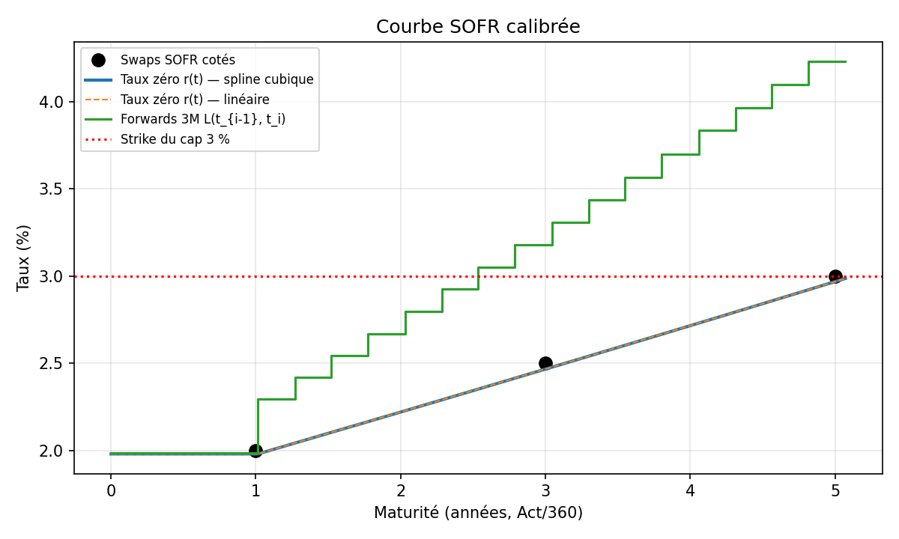

# Calibrage d'une courbe de swap SOFR et pricing d'un cap/floor

Projet de finance quantitative (FICC) : bootstrap d'une courbe de taux zéro à partir de swaps SOFR, puis pricing d'un cap 5 ans à 3 % par la formule de Black, avec analyse de sensibilité.

## Résultats principaux

| Indicateur | Valeur |
| --- | --- |
| Prix du cap 5 ans à 3 % (N = 10 M$, σ = 20 %) | 223 799 $ |
| Prix du floor 5 ans à 3 % | 214 377 $ |
| Erreur max de re-pricing des swaps | 1,2e-12 pb |
| Vega (+1 point de vol) | 6 572 $ |
| DV01 (+1 pb parallèle) | 2 087 $ |
| Temps de calcul | < 10 ms |



## Méthode

1. **Bootstrap** des facteurs d'actualisation à partir des swaps 1, 3 et 5 ans (2 et 4 ans interpolés), jambe fixe annuelle, base Act/360.
2. **Interpolation** des taux zéro continus par spline cubique naturelle.
3. **Forwards trimestriels** lus sur la courbe.
4. **Formule de Black** pour chaque caplet ; prix du cap = somme des caplets 2 à 20.
5. **Contrôles** : re-pricing des swaps, parité cap-floor, cas de la courbe plate.
6. **Sensibilités** : prix vs σ, vega, chocs parallèles, deltas par pilier.

Le détail est dans le rapport [`report/rapport.tex`](report/rapport.tex).

## Structure du dépôt

```
.
├── sofr_cap_pricing.py   # code complet (courbe, pricing, sensibilités, graphiques)
├── tests/
│   └── test_pricing.py   # tests de non-régression (pytest)
├── figures/              # graphiques générés par le script
├── report/
│   └── rapport.tex       # rapport LaTeX
├── requirements.txt
└── README.md
```

## Utilisation

```bash
pip install -r requirements.txt
python sofr_cap_pricing.py     # affiche les résultats et régénère ./figures
pytest                         # lance les tests
```

Compiler le rapport :

```bash
cd report
pdflatex rapport.tex
pdflatex rapport.tex
```

## Limites et pistes

Volatilité plate (pas de smile ni de structure par terme), pas de données avant 1 an, forward simple utilisé comme proxy du SOFR composé, dates non ajustées en jours ouvrés. Pistes : stripping des vols caplets, SABR, Black décalé ou Bachelier, modèle de taux composé (Lyashenko-Mercurio).

## Auteur

Olivier TAGALI
